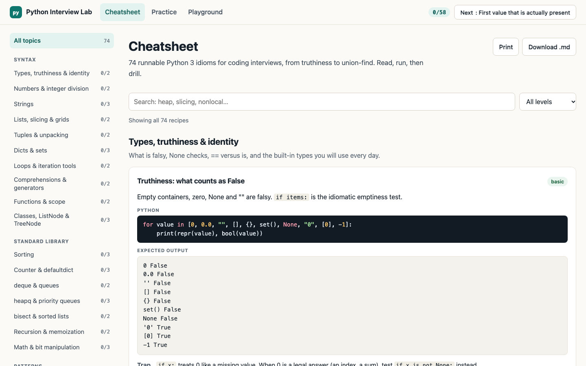
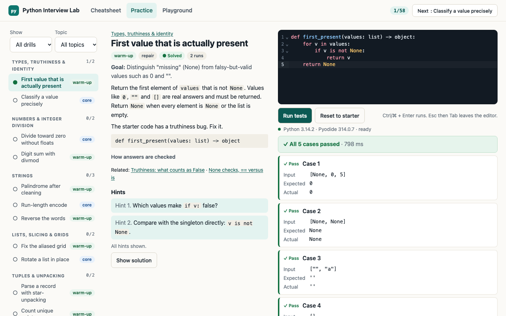
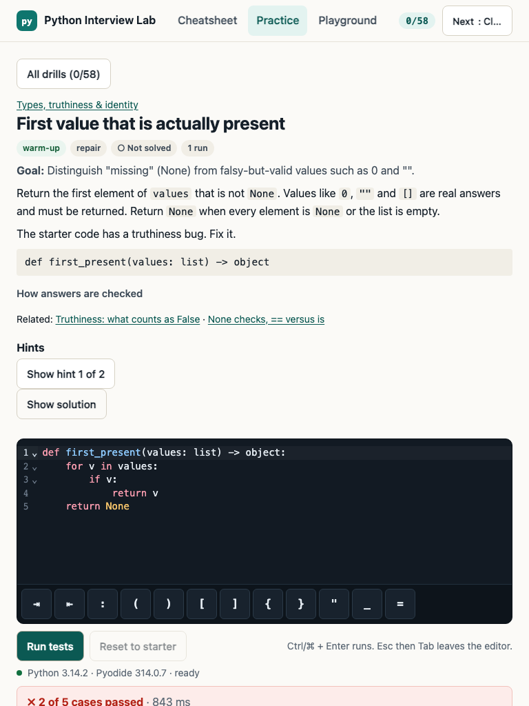
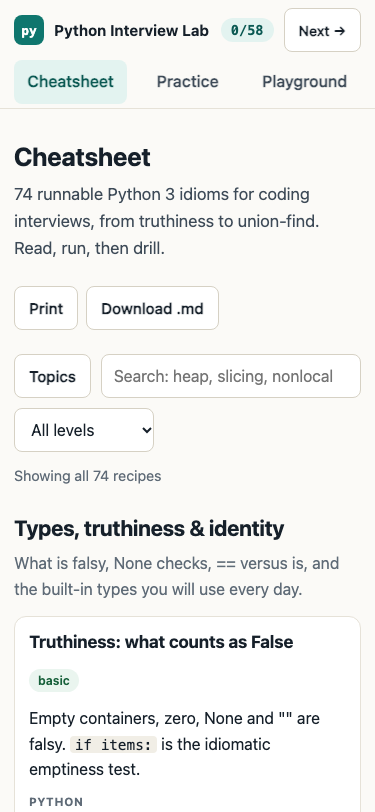
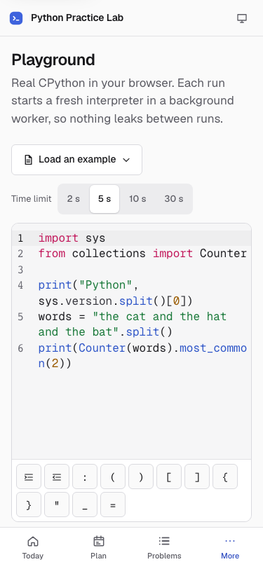

# Python Interview Lab

Build Python 3 *fluency* for coding interviews: look up an idiom, run it, solve a small drill, get real feedback, and revisit weak topics. Everything runs in the browser, with real CPython compiled to WebAssembly ([Pyodide](https://pyodide.org/)). You do not need to install Python, sign in, or use a backend.



| Practice on a desktop (graded run) | Practice on a tablet | Cheatsheet on a phone | Playground on a phone |
| --- | --- | --- | --- |
|  |  |  |  |

## What it is (and is not)

Interviews test two different skills:

- **Algorithms:** choosing the right approach (two pointers, BFS, DP, …).
- **Python syntax and idioms:** expressing that approach quickly and correctly: `//` with negative numbers, aliasing in `[[0] * n] * m`, `heapq` tie-breakers, `nonlocal`, `bisect`, `Counter`, …

This lab focuses on the second skill and connects it to the first. It is not a dump of memorised LeetCode solutions. Pattern drills exist so that you practise the *Python* of each pattern.

| | Count | Content |
| --- | --- | --- |
| **Cheatsheet** | 74 recipes in 25 topics | What and when, runnable code, its exact output, complexity where it matters, and the trap interviewers look for. Search, topic and level filters, shareable links, and "Run here" in the browser. |
| **Practice** | 58 graded drills | Implement, repair a pitfall, apply an idiom, or complete a pattern. Each drill has an objective, a starter, progressive hints, a reference solution with an explanation, and 3–9 deterministic cases. |
| **Playground** | — | Free-form code with stdout, stderr, tracebacks, an optional stdin box, Stop, and a time limit you can set. |

The cheatsheet is also available as Markdown in [`docs/CHEATSHEET.md`](docs/CHEATSHEET.md), generated from the same data. Use **Print** or **Download .md** in the app.

## Run it locally

Requirements: Node.js 22.12+, 24 or 26+ (the range the locked Vitest supports; tested with 26.8.1, CI uses 24) and npm.

```bash
npm ci
npm run dev        # http://localhost:5173/  (copies the Pyodide runtime into public/pyodide first)
```

Production build, served under the GitHub Pages subpath:

```bash
npm run build
npm run preview    # http://127.0.0.1:4173/python-interview-lab/
```

## Tests

```bash
npm run typecheck          # TypeScript 7 (tsc --noEmit)
npm run test:unit          # content validation, CHEATSHEET.md drift, storage/progress rules, router, runner races (fake worker), independent cross-checks
npm run test:corpus        # REAL Pyodide in Node: every recipe's output, every reference solution, starters and known-wrong solutions must fail
npm run test:portability   # the same corpus under native CPython 3.11 (needs `uv`); items marked 3.12+/3.14 are skipped
npx playwright install chromium firefox webkit   # once
npm run build && npm run test:e2e   # real browsers, real Pyodide: 375×812, 768×1024, 1440×900 in Chromium; runtime checks in Firefox and WebKit
npm run cheatsheet         # regenerate docs/CHEATSHEET.md after editing content
```

`npm run check` runs typecheck, unit + corpus tests, the build and the E2E suite in sequence.

The **mocked** tests are only the deterministic boundary tests: runner load failure, timeouts and Stop races (a fake worker), storage corruption and quota errors, and injected network failures in the browser. Every test that claims Python behaviour uses the real runtime.

## Runtime and network

| Item | Version |
| --- | --- |
| Pyodide | 314.0.7 (npm `pyodide`, pinned in `package-lock.json`) |
| CPython inside Pyodide | 3.14.2 |
| Editor | CodeMirror 6 with `@codemirror/lang-python` |
| App | React 19.3, Vite 8.3, TypeScript 7.0 |

- The runtime is **self-hosted**. At build time it is copied from the exact npm package into `dist/pyodide/`, and it is served from the same origin as the app. No CDN is used at runtime.
- **Download size:** the runtime is about 13.5 MB uncompressed (about 6.3 MB with gzip). It downloads only when you first press Run, and the browser caches it afterwards. Reading the cheatsheet never needs it.
- After the page has loaded, the cheatsheet keeps working if the network drops (tested). This is **not** an offline-first app: there is no service worker, and a cold visit needs the network.

## Browser support and limits

- Tested with Playwright in Chromium 156, Firefox 157 and WebKit 27.2, at phone, tablet and desktop viewport sizes.
- **Not verified on real devices.** Touch and viewport emulation does not prove iOS Safari or Android Chrome behaviour, especially for software keyboards. Treat real mobile devices as untested.
- On touch screens, an extra key row (Tab, dedent, `: ( ) [ ] { } " _ =`) appears under the editor. The editor font is 16 px on phones so that iOS does not zoom on focus.
- Keyboard: Ctrl/⌘ + Enter runs the code. In the editor, Tab indents; press **Esc, then Tab** to move focus out.

## Your data

Progress, drafts and playground code are stored **only in this browser** (localStorage, keys `pil:v1:*`). There is no account, sync, analytics or server. If saving fails (private mode, quota, corrupt data), a warning is shown and the app keeps working in memory. Unreadable data is kept under a `pil:v1:corrupt:*` key instead of being deleted. Use **About → Export/Import progress** to move between browsers.

A drill counts as **solved** only when a specific version of your code passes every case of the current drill version. Viewing the solution is tracked as "solved after viewing the solution". A later failing run does not erase an earlier solve.

## Architecture, isolation and cancellation

Read [`docs/architecture.md`](docs/architecture.md), which covers decisions, prior art and the design review. In short:

- Each Run or grading creates a **fresh module worker with a fresh interpreter** and then terminates it. Python never runs on the UI thread.
- The UI thread owns two deadlines: one for startup (90 s) and one for execution (5 s by default; the Playground offers 2, 5, 10 or 30 s). **Stop** and both timeouts call `worker.terminate()`. This needs neither `SharedArrayBuffer` nor cross-origin isolation headers, so it works on GitHub Pages.
- Only one run can be active at a time. Results carry the identity of the run and of the source, so a stale result can never grade a different drill or draft. Leaving a page stops its run.
- Combined stdout and stderr are capped at 64 KiB per run, inside the worker, before anything is posted to the page. Per-case reports and reprs are bounded too.
- Grading happens in Python (`src/runtime/harness.py`), never by comparing printed output or JavaScript-converted values. The comparison is type-strict, and each drill states its comparison policy (unordered, in-place mutation, linked list or tree shape, and so on).

**Security:** the worker isolates *responsiveness*, not security. Code in Pyodide can reach browser APIs, including the network, with this page's permissions. Stop cannot prevent memory exhaustion. Tests and solutions ship with the page, so scores are self-study feedback, not credentials. Saved or imported code never runs automatically.

## Deploying (GitHub Pages)

`.github/workflows/ci.yml` runs on pull requests and pushes. It installs from the lockfile and runs the typecheck, the unit and Pyodide corpus tests, the build and the Playwright suite. `.github/workflows/pages.yml` deploys `dist/` from the `dev` branch to GitHub Pages. Its deploy job has only `pages: write` and `id-token: write`, and it refuses to publish if `dev` has moved past the commit it built. The build uses a relative base and hash routes, so it works at any subpath, such as `https://<user>.github.io/python-interview-lab/`, and reloading a deep link works without a 404 fallback.

To enable it: in **Settings → Pages**, set *Source: GitHub Actions*.

## Sources and licenses

- The app code and all curriculum content (recipes, drills, tests, explanations) are original and released under the [MIT License](LICENSE).
- The curriculum was *informed by* four public solution collections and the official Python documentation. No content was copied, and their licenses are not changed by this project. See [`docs/REFERENCES.md`](docs/REFERENCES.md), which lists each source, its license, and the Python 2 relics it contains.
- Third-party software, including the shipped Pyodide runtime (MPL-2.0, which bundles CPython under the PSF license), is listed in [`THIRD_PARTY_NOTICES.md`](THIRD_PARTY_NOTICES.md).
